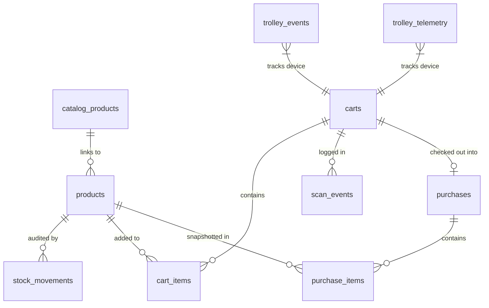

# Supabase Database Documentation & Migration Guide

This document provides complete documentation for the production-grade PostgreSQL / Supabase database powering the **AVCOE Smart Trolley Retail POS & IoT System**.

All definitions are consolidated in [`backend/sql/FINAL_SUPABASE_SCHEMA.sql`](file:///C:/Users/Rushikesh/OneDrive/Pictures/Desktop/iot/backend/sql/FINAL_SUPABASE_SCHEMA.sql).

---

## 1. Entity-Relationship Architecture



---

## 2. Table Specifications & Constraints

### 1. `catalog_products` (Master Catalog)
Central directory of all products across the retail chain.
* `id` (UUID, Primary Key, Default: `gen_random_uuid()`): Unique product identifier.
* `barcode` (TEXT, Unique, Nullable): Standard GS1 EAN-13, UPC-A, or Code 128 barcode.
* `sku` (TEXT, Unique, NOT NULL): Stock Keeping Unit code (e.g. `DAIRY-MILK-1L`).
* `name` (TEXT, NOT NULL): Clean commercial product name.
* `category` (TEXT, NOT NULL, Default: `'General'`): Department categorization.
* `brand` (TEXT, Nullable): Brand manufacturer.
* `description` (TEXT, Nullable): Product details and specs.
* `image_url` (TEXT, Nullable): Hosted product image URL.
* `default_price` (NUMERIC(10,2), NOT NULL, Check $\ge 0$): Benchmark retail price in INR (₹).
* `unit` (TEXT, NOT NULL, Default: `'pc'`): Unit of measurement (`can`, `pack`, `pc`, `kg`, `liter`).
* `is_active` (BOOLEAN, NOT NULL, Default: `true`): Soft deletion flag.
* `created_at`, `updated_at` (TIMESTAMPTZ, Auto-managed via trigger).

### 2. `products` (Store Inventory)
Active stock records present in the local branch/store.
* `id` (UUID, Primary Key, Default: `gen_random_uuid()`).
* `catalog_product_id` (UUID, Foreign Key to `catalog_products.id` ON DELETE SET NULL).
* `barcode` (TEXT, Unique, NOT NULL): Scanned identifier.
* `sku` (TEXT, Nullable, Indexed): Synced SKU.
* `name` (TEXT, NOT NULL): Display name.
* `category` (TEXT, NOT NULL, Default: `'General'`).
* `price` (NUMERIC(10,2), NOT NULL, Check $\ge 0$): Active selling price.
* `gst_percent` (NUMERIC(5,2), NOT NULL, Default: `0.0`, Check $0 \le \text{gst} \le 100$): Applicable tax rate.
* `stock` (INTEGER, Nullable, Check $\text{stock} \ge 0$): Live available quantity.
* `unit` (TEXT, NOT NULL, Default: `'pc'`).
* `active` (BOOLEAN, NOT NULL, Default: `true`).

### 3. `stock_movements` (Immutable Audit Ledger)
Audit trail tracking every single inventory increment or decrement.
* `id` (UUID, Primary Key).
* `product_id` (UUID, Foreign Key to `products.id` ON DELETE CASCADE).
* `change` (INTEGER, NOT NULL): Delta (negative for sales/scan additions, positive for restocks/cancellations).
* `reason` (TEXT, Check in `'sale'`, `'restock'`, `'adjustment'`, `'scan_add'`, `'scan_remove'`, `'cancellation'`).
* `scan_id` (UUID, Nullable): Linked scan identifier for traceability.
* `created_at` (TIMESTAMPTZ, Default: `NOW()`).

### 4. `carts` (Shopping Carts)
Active customer carts tied to physical trolley robots or virtual kiosk sessions.
* `id` (UUID, Primary Key).
* `trolley_id` (TEXT, Default: `'trolley-01'`).
* `status` (TEXT, Check in `'open'`, `'checked_out'`, `'cancelled'`).
* `created_at`, `updated_at` (TIMESTAMPTZ).

### 5. `cart_items` (Cart Line Items)
Active items currently inside a shopping cart.
* `id` (UUID, Primary Key).
* `cart_id` (UUID, Foreign Key to `carts.id` ON DELETE CASCADE).
* `product_id` (UUID, Foreign Key to `products.id` ON DELETE RESTRICT).
* `quantity` (INTEGER, Check $> 0$).
* **Constraint**: `UNIQUE(cart_id, product_id)`.

### 6. `scan_events` (Scan Idempotency Audit Log)
High-throughput log of all scans preventing duplicate charges via client-generated UUIDs.
* `id` (UUID, Primary Key).
* `scan_id` (UUID, Unique, NOT NULL): Client-generated idempotency key.
* `cart_id` (UUID, Foreign Key to `carts.id` ON DELETE SET NULL).
* `barcode` (TEXT, NOT NULL).
* `product_id` (UUID, Foreign Key to `products.id` ON DELETE SET NULL).
* `result` (TEXT, Check in `'added'`, `'unknown'`, `'duplicate'`, `'rejected'`, `'out_of_stock'`).
* `created_at` (TIMESTAMPTZ, Default: `NOW()`).

### 7. `purchases` (Order Invoices)
Completed transactions finalized at checkout.
* `id` (UUID, Primary Key).
* `cart_id` (UUID, Foreign Key to `carts.id` ON DELETE SET NULL).
* `trolley_id` (TEXT, Default: `'trolley-01'`).
* `subtotal` (NUMERIC(10,2), Check $\ge 0$).
* `gst_total` (NUMERIC(10,2), Check $\ge 0$).
* `total` (NUMERIC(10,2), Check $\ge 0$).
* `status` (TEXT, Check in `'completed'`, `'cancelled'`).
* `payment_method` (TEXT, Check in `'cash'`, `'card'`, `'upi'`, `'mock'`).
* `cancelled_at` (TIMESTAMPTZ, Nullable).
* `created_at` (TIMESTAMPTZ, Default: `NOW()`).

### 8. `purchase_items` (Historical Line Item Snapshots)
Frozen snapshots preserving the price and tax rate as they were at transaction time.
* `id` (UUID, Primary Key).
* `purchase_id` (UUID, Foreign Key to `purchases.id` ON DELETE CASCADE).
* `product_id` (UUID, Foreign Key to `products.id` ON DELETE SET NULL).
* `name`, `price`, `gst_percent`, `quantity`, `line_subtotal`, `line_gst`, `line_total`.

### 9. `trolley_events` (Hardware Diagnostics)
Logs all hardware state changes and operational flags.
* `id` (UUID, Primary Key).
* `device_id` (TEXT, NOT NULL).
* `event` (TEXT, NOT NULL).
* `severity` (TEXT, Check in `'info'`, `'warning'`, `'error'`, `'critical'`).
* `message` (TEXT, Nullable).
* `device_ts` (BIGINT, Nullable).
* `received_at` (TIMESTAMPTZ, Default: `NOW()`).

### 10. `trolley_telemetry` (Sampled Hardware Telemetry)
JSONB-based periodic telemetry records from the ESP32 robot.
* `id` (UUID, Primary Key).
* `device_id` (TEXT, NOT NULL).
* `payload` (JSONB, NOT NULL): Holds battery voltage, battery percentage, RSSI, speed, obstacle distance, weight, motor status.
* `recorded_at` (TIMESTAMPTZ, Default: `NOW()`).

### 11. `system_settings` (Configuration Store)
Key-value configuration store for runtime POS rules, thresholds, and store identity.
* `key` (TEXT, Primary Key).
* `value` (JSONB, NOT NULL).
* `description` (TEXT, Nullable).

---

## 3. Real-Time Analytical Views & Functions

1. **`view_daily_sales_stats`**: Pre-aggregates daily order counts, gross subtotal, total GST, and gross revenue for lightning-fast dashboard charts.
2. **`view_category_sales`**: Computes units sold and revenue share per retail department.
3. **`view_inventory_summary`**: Instant count of out-of-stock items, low-stock items, healthy stock items, and total monetary inventory valuation.
4. **`view_latest_trolley_telemetry`**: Utilizes PostgreSQL `DISTINCT ON (device_id)` to retrieve each robot's most recent heartbeat instantly without scanning millions of historical rows.
5. **`fn_get_admin_dashboard_kpis()`**: High-performance PostgreSQL RPC function returning all executive KPIs in a single JSON round-trip.

---

## 4. Supabase Migration Instructions

### For Existing Databases:
If your database already contains tables from previous versions:
1. Open the **SQL Editor** in your [Supabase Dashboard](https://supabase.com/dashboard).
2. Copy the contents of [`backend/sql/FINAL_SUPABASE_SCHEMA.sql`](file:///C:/Users/Rushikesh/OneDrive/Pictures/Desktop/iot/backend/sql/FINAL_SUPABASE_SCHEMA.sql).
3. Click **"Run"**. All `CREATE TABLE IF NOT EXISTS`, `CREATE INDEX IF NOT EXISTS`, and `CREATE OR REPLACE VIEW` statements are completely non-destructive and idempotent.

### For Fresh Supabase Projects:
1. Create a new Supabase Project.
2. Open the **SQL Editor**.
3. Paste and run `FINAL_SUPABASE_SCHEMA.sql`.
4. Copy your **Project URL** and **service_role secret key** into `backend/.env`.
5. Populate demo retail products by running:
   ```bash
   node backend/scripts/seed_catalog.js
   ```
